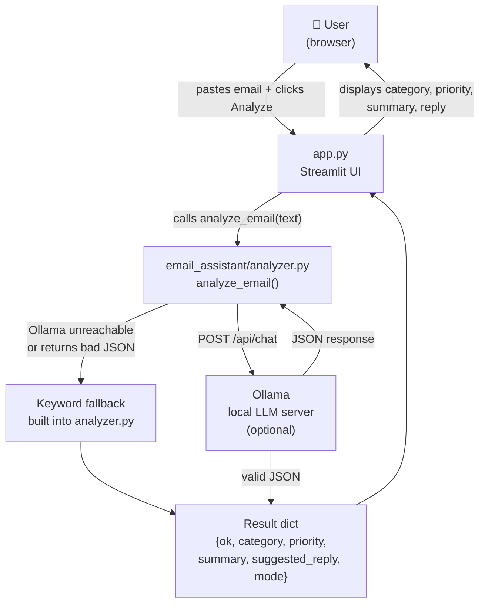

# ✉️ AI Email Assistant

A beginner-friendly local web app that reads a pasted email and instantly tells
you what it is, how urgent it is, what it says in plain English, and offers a
draft reply for you to review — all without sending your email to any external
service.

---

## Table of Contents

1. [Problem it solves](#1-problem-it-solves)
2. [Features](#2-features)
3. [Architecture](#3-architecture)
4. [Project structure](#4-project-structure)
5. [Windows setup](#5-windows-setup)
6. [Run the app](#6-run-the-app)
7. [Run the tests](#7-run-the-tests)
8. [Using Ollama (optional local AI)](#8-using-ollama-optional-local-ai)
9. [Fallback mode explained](#9-fallback-mode-explained)
10. [Example input and output](#10-example-input-and-output)
11. [Known limitations](#11-known-limitations)
12. [Future improvements](#12-future-improvements)

---

## 1. Problem it solves

A busy inbox makes it hard to decide what needs attention first. This app helps
by scanning a pasted email and answering four questions:

| Question | Answer the app provides |
|---|---|
| What kind of email is this? | Category: Customer Support, Sales, Billing, Meeting, or Other |
| How urgent is it? | Priority: Low, Medium, or High |
| What does it say in brief? | A one- or two-sentence summary |
| How should I start replying? | A draft reply for a human to review before sending |

The whole process takes one click and runs entirely on your own computer — no
account needed, no email address collected, nothing sent to the cloud.

---

## 2. Features

### ✅ Implemented

- **Paste-and-click UI** — a single text area and one button; results appear
  below immediately.
- **Five email categories** — Customer Support, Sales, Billing, Meeting, Other.
- **Three priority levels** — High, Medium, Low, driven by keyword rules.
- **Automatic summary** — the first one or two sentences of the email, capped
  at 280 characters.
- **Draft reply** — a clearly labelled template for the human to edit before
  sending.
- **Local AI via Ollama** — if [Ollama](https://ollama.com) is running on your
  computer the app sends the email to it and uses the AI result instead of the
  keyword rules.
- **Honest mode labels** — the UI always shows either **Fallback mode** or
  **Local AI (Ollama)**. It never claims AI was used when it was not.
- **Keyword fallback** — works with no AI installed, no internet connection, and
  no API key.
- **Privacy by design** — the pasted text is held in memory for the duration of
  one analysis click and then discarded. It is never written to a file, logged,
  or sent to an external provider.
- **Read-only reply box** — the suggested reply box is deliberately non-editable
  so the app cannot be mistaken for an email sender.
- **33 automated tests** — cover empty input, every category, every error path,
  mocked Ollama responses, and helper-function edge cases.

### 🔮 Planned (not yet built — see [Future improvements](#12-future-improvements))

- Confidence scores on the classification result.
- Support for multiple Ollama models selectable from the UI.
- Batch analysis of several emails at once.
- Export results to a text file.

---

## 3. Architecture



**Key design rule:** `app.py` only draws the page. All classification logic lives
in `email_assistant/analyzer.py`. This separation means the business logic can be
tested without a browser or a running Streamlit server.

---

## 4. Project structure

```
email-assitant/
│
├── app.py                        # Streamlit UI — paste box, button, results
├── conftest.py                   # Tells pytest where the project root is
├── requirements.txt              # Third-party dependencies (3 packages)
├── .gitignore                    # Excludes .venv, __pycache__, secrets, etc.
├── README.md                     # This file
│
├── email_assistant/
│   ├── __init__.py               # Makes email_assistant a Python package;
│   │                             # exports analyze_email for convenience
│   └── analyzer.py               # All classification, summary, Ollama, fallback
│
└── tests/
    └── test_analyzer.py          # 33 pytest tests; no live server required
```

---

## 5. Windows setup

> **Prerequisites:** Python 3.10 or later. Download from
> [python.org](https://www.python.org/downloads/) and tick
> *"Add Python to PATH"* during install.

Open **PowerShell** and run these commands one at a time.

### Step 1 — Clone or download the project

If you have Git:

```powershell
git clone https://github.com/your-username/email-assitant.git
cd email-assitant
```

Or download the ZIP from GitHub, unzip it, and open PowerShell inside the
folder.

### Step 2 — Create a virtual environment

```powershell
python -m venv .venv
```

This creates a `.venv` folder that holds the project's Python packages
separately from the rest of your system.

### Step 3 — Activate the virtual environment

```powershell
.\.venv\Scripts\Activate.ps1
```

Your prompt will change to show `(.venv)` when it is active.

> **Tip:** If PowerShell says *"running scripts is disabled"*, run this once and
> then try again:
> ```powershell
> Set-ExecutionPolicy -Scope CurrentUser RemoteSigned
> ```

### Step 4 — Install dependencies

```powershell
pip install -r requirements.txt
```

This installs three packages: `streamlit`, `requests`, and `pytest`.

---

## 6. Run the app

Make sure the virtual environment is active (you see `(.venv)` in your prompt),
then:

```powershell
streamlit run app.py
```

Streamlit will print a local URL — usually:

```
Local URL: http://localhost:8501
```

Open that address in your browser. You will see the paste box. Paste any email
text, click **Analyze Email**, and the results appear below the button.

To stop the app press `Ctrl+C` in PowerShell.

---

## 7. Run the tests

With the virtual environment active:

```powershell
pytest
```

Or for a detailed view of each test:

```powershell
pytest tests/test_analyzer.py -v
```

No live Ollama server is needed. All tests that touch the network replace
`requests.post` with a mock object, so the suite works fully offline.

Expected output:

```
33 passed in 0.26s
```

---

## 8. Using Ollama (optional local AI)

Ollama lets you run a large language model on your own computer. When Ollama is
running, the app sends the email to it and uses the AI result instead of the
built-in keyword rules. The AI can handle phrasing that the keywords would miss.

### Install Ollama

Download from [ollama.com](https://ollama.com) and follow the installer.

### Pull the default model

```powershell
ollama pull llama3.2
```

This downloads the Llama 3.2 3B model (~2 GB). It only needs to happen once.

### Start Ollama

```powershell
ollama serve
```

Keep this window open while you use the app. Ollama listens on
`http://localhost:11434` by default.

### Verify it is running

```powershell
curl http://localhost:11434
```

You should see `Ollama is running`.

### Environment variables

You can change the defaults without editing any code by setting environment
variables **before** starting the app:

| Variable | Default | Purpose |
|---|---|---|
| `OLLAMA_CHAT_URL` | `http://localhost:11434/api/chat` | Address of the Ollama chat endpoint |
| `OLLAMA_MODEL` | `llama3.2` | Model tag Ollama should use |

Example — use a different model:

```powershell
$env:OLLAMA_MODEL = "llama3.2:1b"
streamlit run app.py
```

### What the app shows

| Ollama state | Mode label in the UI | Colour |
|---|---|---|
| Running and returns valid JSON | **Local AI (Ollama)** | Green ✅ |
| Not running, times out, or returns bad JSON | **Fallback mode** | Blue ℹ️ |

---

## 9. Fallback mode explained

The fallback is a set of keyword rules built into `analyzer.py`. It runs
whenever Ollama is unavailable or returns output the app cannot trust.

### How categories are assigned

The fallback checks for keywords in this priority order. The first match wins.

| Category | Keywords checked |
|---|---|
| Billing | invoice, payment, refund, billing, charge, receipt |
| Meeting | meeting, calendar, schedule, appointment, zoom, call |
| Sales | quote, pricing, demo, purchase, discount, proposal, buy |
| Customer Support | error, broken, help, not working, issue, bug, unable, support |
| Other | *(no keywords matched)* |

### How priority is assigned

1. If any of these words appear anywhere in the email → **High**: `urgent`, `asap`, `immediately`, `emergency`, `critical`
2. If category is Customer Support or Billing → **Medium**
3. Everything else → **Low**

### How the summary is made

The first one or two sentences of the email are used verbatim (whitespace
normalised). If the result exceeds 280 characters it is truncated with `...`.

### How the suggested reply is made

A fixed template is returned:

```
[Template reply — Fallback mode] Thank you for your email. I have noted this
as a <Category> message with <Priority> priority. Please review this draft
before sending. A teammate will follow up with the next step.
```

The `[Template reply — Fallback mode]` prefix is intentional — it makes it
obvious this text was generated automatically and has not been reviewed.

---

## 10. Example input and output

### Input (paste this into the app)

```
Subject: Invoice #4821 — extra charge

Hello,

I received invoice #4821 this morning but it includes a charge of £150 that
I did not authorise. Could you please issue a refund at your earliest
convenience? This is quite urgent as our accounts close at the end of the week.

Many thanks,
Alex
```

### Output — Fallback mode (Ollama not running)

| Field | Value |
|---|---|
| **Mode** | Fallback mode |
| **Category** | Billing |
| **Priority** | High |
| **Summary** | I received invoice #4821 this morning but it includes a charge of £150 that I did not authorise. |
| **Suggested reply** | [Template reply — Fallback mode] Thank you for your email. I have noted this as a Billing message with High priority. Please review this draft before sending. A teammate will follow up with the next step. |

**Why Billing?** The words *invoice* and *refund* match the Billing keyword list.  
**Why High?** The word *urgent* matches the high-priority keyword list.

### Output — Local AI mode (Ollama running with llama3.2)

The category and priority will typically match the fallback result. The summary
and suggested reply will be written in natural language by the model rather than
extracted directly from the email text or filled from a template.

---

## 11. Known limitations

| Limitation | Detail |
|---|---|
| **Keyword rules are simple** | The fallback cannot understand context. "I hope this doesn't become an *issue*" triggers Customer Support even though it is not a complaint. |
| **One category per email** | An email that is both a billing query and a meeting request gets the first matching category only. |
| **Summary is the first sentence(s)** | If an email buries its main point in the middle, the summary will miss it. |
| **Ollama model must be pulled manually** | The app does not download or manage models. `ollama pull <model>` must be run separately. |
| **30-second timeout** | If Ollama takes longer than 30 seconds the app silently falls back. There is no progress indicator while waiting. |
| **No email sending** | The app produces a draft reply for you to copy. It cannot send email. |
| **English only** | The keyword lists are in English. The fallback will classify non-English email as Other. Ollama may handle other languages depending on the model. |
| **Single user, local only** | The app is designed to run on one person's computer. It has no login, no multi-user support, and no deployment configuration. |

---

## 12. Future improvements

These ideas are not implemented. They are recorded here as a learning roadmap.

- **Confidence score** — show how certain the keyword rules are (e.g. "3 billing
  keywords matched") so the user knows when to double-check.
- **Model selector** — let the user choose between installed Ollama models from
  a dropdown in the UI instead of setting an environment variable.
- **Batch mode** — paste or upload multiple emails and get a table of results.
- **Export** — download results as a CSV or text file.
- **Streaming replies** — show the Ollama-generated reply word by word as it
  arrives, so there is visible progress during the 30-second window.
- **Custom categories** — let the user add their own keyword groups through the
  UI without editing Python code.
- **Tests for `app.py`** — the current tests cover `analyzer.py` only. Adding
  Streamlit component tests would give end-to-end coverage of the UI layer.

---

## Tech stack

| Tool | Version | Role |
|---|---|---|
| Python | 3.10+ | Language |
| Streamlit | 1.66.1 | Browser UI |
| Requests | 2.34.2 | HTTP calls to Ollama |
| Ollama | any | Optional local LLM server |
| pytest | 9.1.1 | Test runner |

---

## Privacy

The pasted email text is used for one analysis request and then discarded. The
app does not write it to a file, print it to logs, or send it to any external
server. If Ollama is running locally, the text is sent to
`http://localhost:11434` — a port on your own computer — and nowhere else.

---

*Built as a learning project. Contributions and suggestions welcome.*
